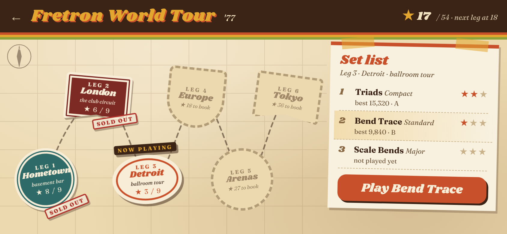
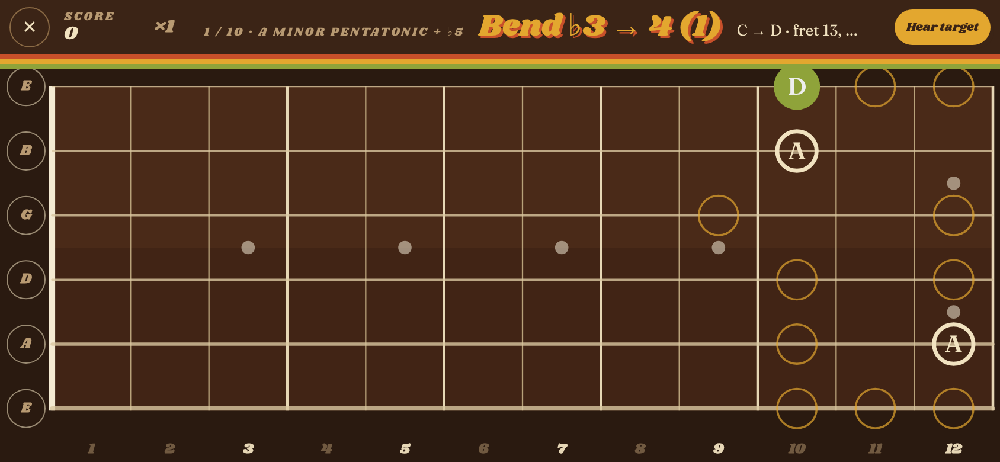
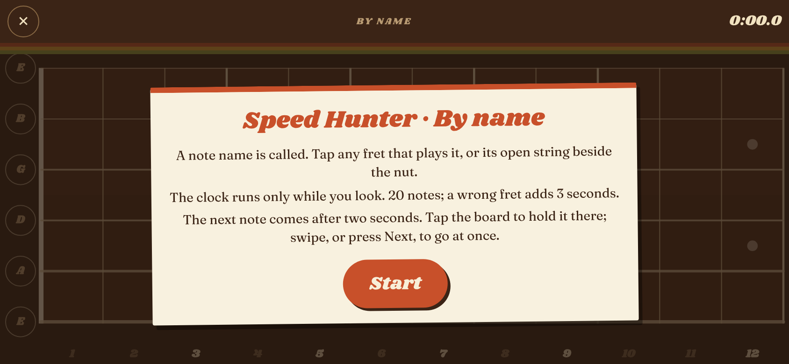

# World Tour: design sketch

A second way into the same games. You go on tour: each stop on the tour is one of the existing games, played exactly as it is today, and how well you play it earns stars. Stars book the next leg of the tour. Every stop can be replayed to raise its stars. The whole mode wears a 1970s rock tour look (tour posters, travel stickers, album-sleeve colours) in place of the Tron grid.

The game screens above are the real app with the skin applied, not drawings. Compare with [today's intro panel](current-intro-for-comparison.png).

## The tour

18 stops, each of the existing modes once. The order cycles through the three kinds of exercise (notes, then triads, then bends) in runs of one or two. Each time it comes back round, that kind is a step harder. The tour then cuts that order into six legs of three.

| Round | Notes | Triads | Bends |
|---|---|---|---|
| 1 | Speed Hunter · By name, Fret Sweeper · By note | Progressions | Bend by Ear · Standard, Scale Bends · Blues |
| 2 | Speed Hunter · By ear | Compact | Bend Trace · Standard, Scale Bends · Major |
| 3 | Fret Sweeper · Random | Targets | Bend by Ear · Advanced, Scale Bends · Minor |
| 4 | Speed Hunter · Advanced | Grid clear | Bend Trace · Advanced |
| Encore | | | Bend by Ear · Virtuoso, Bend Trace · Virtuoso |

| Leg | Sticker | Stop 1 | Stop 2 | Stop 3 |
|---|---|---|---|---|
| 1 | Hometown, basement bar | Speed Hunter · By name | Fret Sweeper · By note | Triads · Progressions |
| 2 | London, club circuit | Bend by Ear · Standard | Scale Bends · Blues | Speed Hunter · By ear |
| 3 | Detroit, ballroom tour | Triads · Compact | Bend Trace · Standard | Scale Bends · Major |
| 4 | Europe, theatres | Fret Sweeper · Random | Triads · Targets | Bend by Ear · Advanced |
| 5 | Arenas | Scale Bends · Minor | Speed Hunter · Advanced | Triads · Grid clear |
| 6 | Tokyo, stadium | Bend Trace · Advanced | Bend by Ear · Virtuoso | Bend Trace · Virtuoso |

There are 9 bend modes and only 4 triad modes, so bends come up most often, and the last leg is all bends: the two Virtuoso modes are the headline encore. Inside a leg, the stops can be played in any order.

## Stars, booking and replay

- **Stars come from the rank**, because the rank is the one thing every game already shares: timed games and point games both end in S, A, B or C (`core/modes.ts`). S is 3 stars, A is 2, B is 1, C is 0 (you played the gig, but nobody came).
- **A stop keeps its best rank.** Replaying can only add stars, never lose them, so a bad night costs nothing.
- **Legs are booked by total stars**, not by clearing every stop, so one stubborn game never walls you off. Thresholds: leg 2 at 4, leg 3 at 10, leg 4 at 18, leg 5 at 27, leg 6 at 36, out of 54. Roughly a B average to keep moving, A's to reach the stadium.
- **"Sold out"** is stamped on a leg once every stop is at B or better. A **gold record** on a leg with all three at S is a nice extra for later.

## Scores and settings

- A tour run is an ordinary run: same view, same rules, same scoring. It goes on the normal score table for that mode (same `tableKey`, so the neck length is respected), with initials as usual. No second set of tables.
- The only new saved data is the best rank per stop: `tour: Record<modeId, Rank>` on `SaveData`. `migrate` fills it in as empty for old saves, so `SAVE_VERSION` stays at 1, and export/import carry it for free.
- All settings apply unchanged: hand, neck, voice, sharps and flats, volume. My default is that stars are shared across neck lengths (a 22-fret S counts the same as a 12-fret one); see the questions below.

## Restyling, scoped to the mode

- The skin is one attribute: `<html data-skin="tour">`, set while the hash starts with `/tour` and removed on leaving. Nothing outside the tour sees it.
- A new `styles/tour.css` re-points the existing colour and font tokens under `:root[data-skin='tour']`, plus about 40 lines for things that change shape rather than colour: the three stripes under the top bar, paper panels instead of glowing glass boxes, pill buttons with an offset print shadow. (The mockup's stylesheet is that file in draft.)
- The board is drawn on a canvas that read a few things straight from code: its fill, the cyan wash, the glows and the Orbitron numbers. The mockup branch moves those onto six new tokens (`--board-wood`, `--board-tint`, `--board-glow`, `--board-number-font`, `--board-label-font`, `--board-inlay`). Their defaults are today's values, so the arcade look does not change. The board reads its theme when it is built, and a game screen builds a new board each time, so switching skin between routes just works.
- Fonts: Shrikhand for display and Fraunces for text. Because the build inlines everything into one page, they add about 70 KB (upright Fraunces only) or 130 KB (with italics) to a 160 KB page. I'd drop the italics or load the tour fonts only when the tour is opened.
- Still to sweep in the build: banners, the result card, the score table and the combo text, which use glows written straight into `app.css`.

## How it would be built

- `core/tour.ts`: the legs as data, `starsFor(rank)`, `starsTotal(save)`, `legBooked(save, leg)`. Pure functions with tests, like the rest of `core/`.
- `app/views/tour.ts`: the map and the set list. Tapping a sticker shows its set list; Play goes to the stop.
- Routes: each game route is registered a second time under `/tour` (for example `/tour/play/hunter/:variant`) with the same view. In `showResult`, a tour run also records the rank, shows the stars it earned (and any leg it just booked), and its Menu button goes back to the tour.
- An entry point: a fourth item in the top bar, or a tour-poster card at the top of the Games page.

## Questions for Rob

1. **Palette.** The mockups use earthy rust, mustard and olive on brown, like a 1970s tour poster. The other way is darker and more psychedelic: black with a rainbow prism spectrum. Which one?
2. **Type.** Shrikhand is groovy and round. A harder-rock option would be a heavy art-nouveau or blackletter display face. Keep the groovy one?
3. **Places.** Real cities (London, Detroit, Tokyo) or invented ones?
4. **Name.** "Fretron World Tour '77"? Another year or name?
5. **The board.** Rosewood with pearl dots (as shown), or keep it dark and neutral so the notes stand out more?
6. **Album-sleeve art.** Each leg could get a small drawn emblem that nods to a 1970s sleeve (a prism, an airship, a pig in the sky). These would be our own drawings in that spirit, not copies of real covers. Want them?
7. **Sound.** Turn on the Guitar voice by default inside the tour, and add a short crowd cheer when a stop earns stars?
8. **Neck length.** Share stars across neck lengths (my default), or keep a tour per neck length like the score tables?
